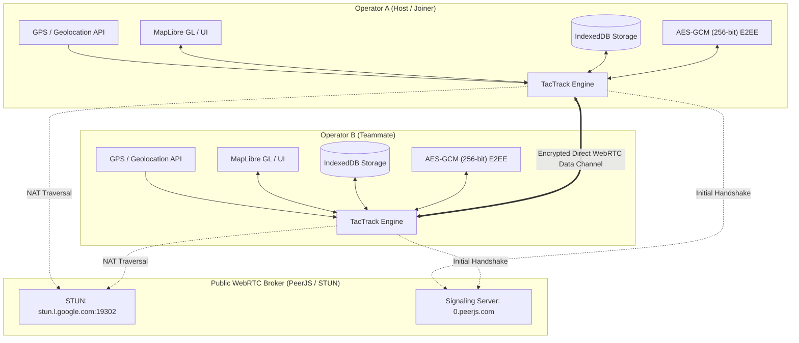

# TacTrack (GroupWatch Realtime)

[](https://react.dev/)
[](https://www.typescriptlang.org/)
[](https://tanstack.com/start)
[](https://tailwindcss.com/)
[](https://webrtc.org/)
[](https://workers.cloudflare.com/)
[](#license)

> **TacTrack** is a serverless, peer-to-peer (P2P) live position sharing and tactical coordination Progressive Web App (PWA) designed for outdoor teams, search & rescue squads, airsoft groups, hikers, and tactical operations.
>
> All GPS telemetry and markers are encrypted end-to-end (AES-GCM 256-bit) and communicated directly between devices via WebRTC data channels without routing through central servers.

---

## Table of Contents

- [Key Features](#key-features)
- [System Architecture](#system-architecture)
- [Security & Cryptography](#security--cryptography)
- [Tech Stack](#tech-stack)
- [Project Structure](#project-structure)
- [Getting Started](#getting-started)
- [Available Scripts](#available-scripts)
- [Cloudflare Deployment](#cloudflare-deployment)
- [Progressive Web App (PWA)](#progressive-web-app-pwa)
- [License](#license)

---

## Key Features

### 1. Fully Serverless P2P Telemetry Mesh
- **Direct Device-to-Device Mesh**: Powered by WebRTC (`PeerJS`), devices exchange location coordinates, headings, and markers directly.
- **No Central Database**: No user location or sensitive mission data is stored on external servers or relays.
- **Mesh Self-Healing & Peer Introduction**: Connected peers automatically introduce new participants into the full mesh topology.

### 2. End-to-End Encryption (E2EE)
- **Military-Grade Encryption**: All wire payloads are encrypted using **AES-GCM (256-bit)** with fresh 12-byte initialization vectors (IVs) per transmission.
- **Zero-Knowledge Signaling**: Encryption keys are generated client-side using the Web Crypto API (`crypto.subtle`) and shared strictly out-of-band via URL fragments or visual QR codes.

### 3. Tactical Map & Telemetry Dashboard
- **Vector & Raster Basemaps**: Instant switching between:
  - **OpenStreetMap (Streets)** for urban and road navigation.
  - **Esri World Imagery (Satellite)** for terrain reconnaissance.
  - **OpenTopoMap (Topographic)** with elevation contours for hiking and field maneuvers.
- **Live Operator Status**:
  - Dynamic directional heading arrows synced with device compass/GPS.
  - Real-time speed and GPS accuracy confidence circle indicators.
  - Live battery percentage reporting via the browser Battery Status API.
  - Real-time haversine distance and relative bearing calculation between team members.
- **Auto-Follow Mode**: Toggle camera lock on operator location.

### 4. Collaborative Tactical Markers
- **Real-Time Synchronized Overlays**: Long-press on the map to place tactical waypoints (`pin`, `flag`, `target`, `hazard`, `friendly`, `objective`).
- **Team-Wide Sync**: Instant mesh broadcast and deletion sync across all team members.
- **Offline Persistence**: Markers and rooms are saved locally in client-side IndexedDB (`idb`).

### 5. Seamless Onboarding & PWA Ready
- **QR Code Pairing**: Built-in camera scanner (`html5-qrcode`) and visual QR generator (`qrcode`) for zero-friction room joining with embedded E2EE keys.
- **Installable PWA**: Works offline as a standalone web application on iOS Safari, Android Chrome, and Desktop.
- **Screen WakeLock**: Prevents screen sleep during operations using the Screen Wake Lock API.

---

## System Architecture



---

## Security & Cryptography

| Layer | Implementation |
|---|---|
| **Cipher Algorithm** | AES-GCM (Galois/Counter Mode) with 256-bit key length |
| **IV Generation** | 96-bit (12-byte) cryptographically secure random IV via `crypto.getRandomValues()` |
| **Key Exchange** | Shared via room link query parameter (`?k=...`) or offline QR scan; never exposed to third-party servers |
| **Identity & Privacy** | Pseudo-anonymous callsigns and random UUIDs, client-side persisted in IndexedDB |
| **Data Integrity** | Authenticated encryption tags verify message authenticity; tampering causes automatic drop |

---

## Tech Stack

- **Framework**: [TanStack Start](https://tanstack.com/start) & [TanStack Router](https://tanstack.com/router)
- **Core Library**: [React 19](https://react.dev/)
- **Language**: [TypeScript 5.8](https://www.typescriptlang.org/)
- **Bundler**: [Vite 7](https://vite.dev/) with `@cloudflare/vite-plugin`
- **Styling**: [Tailwind CSS v4](https://tailwindcss.com/) & [tw-animate-css](https://github.com)
- **UI Components**: [Radix UI](https://www.radix-ui.com/), [Lucide React](https://lucide.dev/), [Sonner](https://sonner.emilkowal.ski/)
- **Map & Geo**: [MapLibre GL](https://maplibre.org/)
- **P2P Networking**: [PeerJS](https://peerjs.com/) (WebRTC Data Channels)
- **QR Utilities**: [qrcode](https://www.npmjs.com/package/qrcode) & [html5-qrcode](https://www.npmjs.com/package/html5-qrcode)
- **Local Database**: [idb](https://github.com/jakearchibald/idb) (IndexedDB wrapper)
- **Deployment**: [Cloudflare Workers](https://workers.cloudflare.com/) via Wrangler

---

## Project Structure

```
├── public/                 # Static assets & PWA webmanifest
├── src/
│   ├── components/
│   │   ├── tactrack/       # MapView, QR generator/scanner, marker icons
│   │   └── ui/             # Radix & Tailwind design system primitives
│   ├── hooks/              # Custom React hooks (toast, mobile detection)
│   ├── lib/
│   │   └── tactrack/
│   │       ├── crypto.ts   # AES-GCM encryption, decryption & key utilities
│   │       ├── db.ts       # IndexedDB schema & persistence
│   │       ├── geo.ts      # Geodesic computations (Haversine, bearing, relative time)
│   │       ├── identity.ts # Operator profile & callsign management
│   │       ├── mesh.ts     # WebRTC Mesh coordination & peer lifecycle
│   │       └── types.ts    # Shared TypeScript telemetry & protocol types
│   ├── routes/
│   │   ├── __root.tsx      # Root layout & global metadata
│   │   ├── index.tsx       # Landing page (create room, callsign, recent sessions)
│   │   ├── join.tsx        # QR scanner & code entry room onboarding
│   │   └── room.$code.tsx  # Main tactical radar, map & real-time mesh view
│   ├── router.tsx          # TanStack router bootstrap
│   └── styles.css          # Global CSS & Tailwind variables
├── wrangler.jsonc          # Cloudflare Workers deployment config
├── vite.config.ts          # Vite configuration
└── package.json            # Project dependencies and scripts
```

---

## Getting Started

### Prerequisites

- Node.js 20+ or [Bun](https://bun.sh/)
- Modern web browser with WebRTC and Geolocation support (HTTPS required for GPS permissions)

### Installation

Clone the repository and install dependencies:

```bash
git clone https://github.com/xdsl93/groupwatch-realtime.git
cd groupwatch-realtime
npm install
```

### Development Server

Start the local development server:

```bash
npm run dev
```

Open your browser at `http://localhost:3000` (or the port indicated in your console).

> **Note**: For mobile testing on your local network, ensure your dev server is served over HTTPS or accessed via `localhost` (port forwarding / tunneling) to allow browser Geolocation access.

---

## Available Scripts

| Command | Description |
|---|---|
| `npm run dev` | Starts the local development server |
| `npm run build` | Builds the production bundle |
| `npm run build:dev` | Builds the bundle in development mode |
| `npm run preview` | Runs a local preview of the production build |
| `npm run lint` | Runs ESLint to verify code quality |
| `npm run format` | Formats codebase using Prettier |

---

## Cloudflare Deployment

The application is pre-configured for full-stack deployment on **Cloudflare Workers** using `@cloudflare/vite-plugin` and TanStack Start.

Deploy using Wrangler:

```bash
# Build the project
npm run build

# Deploy to Cloudflare Workers
npx wrangler deploy
```

Configuration can be customized in [`wrangler.jsonc`](wrangler.jsonc).

---

## Progressive Web App (PWA)

TacTrack can be installed directly to the home screen or desktop application shelf:

- **iOS (Safari)**: Tap the **Share** button (`⎋`) → **Add to Home Screen** (`+`).
- **Android (Chrome)**: Tap the menu (`⋮`) → **Install app** / **Add to Home screen**.
- **Desktop (Chrome/Edge)**: Click the **Install** button located inside the address bar.

---

## License

This project is licensed under the MIT License. See [LICENSE](LICENSE) for details.
